<p align="center">
  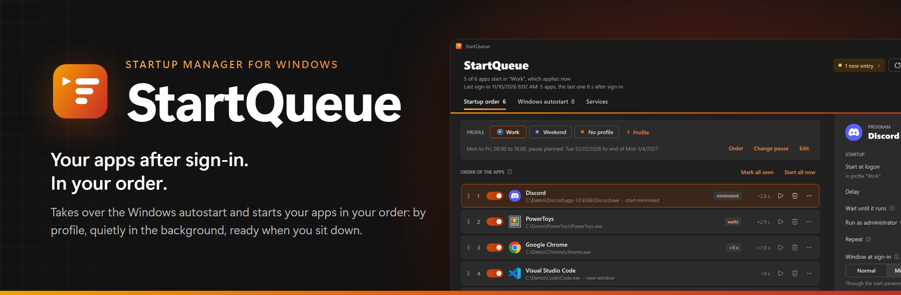
</p>

<h1 align="center">StartQueue: startup manager for Windows</h1>

<p align="center">
  <b>Control what starts when you sign in to Windows, in which order, how and when.</b><br>
  Take over the Windows autostart, start apps in your order, switch by profile, start them quietly in the background,<br>
  have them ready when you sit down, and manage Windows services. Free.
</p>

<p align="center">
  <a href="../../releases/latest"></a>
  
  
</p>

---

When you sign in, Windows launches every autostart app at the same time. They fight over CPU and disk, the desktop takes ages to become usable, and which app shows up when is left to chance. Apps quietly add themselves back to the autostart, open windows you did not ask for, and work tools start on Sunday just like on Monday.

**StartQueue** takes over the Windows autostart and starts your apps **in your order**, right after sign-in: the important ones first, the stragglers at the end. Where an app needs room, give it a delay or let the next one wait until it really runs. Profiles decide what starts on workdays and what on the weekend. Apps come up minimized or in the background instead of in your face. Shut down with **prepared apps**, and they are already there when you unlock the next morning. And everything can be given back to Windows at any time.

<picture>
  <source media="(prefers-color-scheme: light)" srcset="docs/images/hero-light.png">
  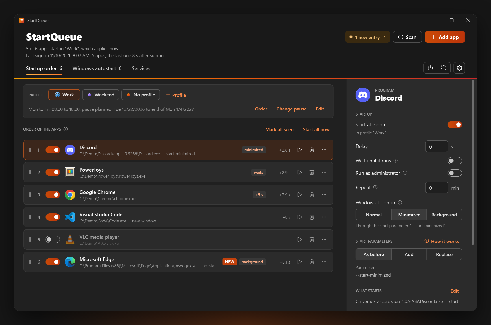
</picture>

## See it in action

| Film | What it shows |
| --- | --- |
| **[Watch the tour](https://esteemworks.github.io/startqueue/)** (1:36, plays in your browser, sound on) | What Windows gives you for the autostart, then everything StartQueue adds: your order, delays, waiting for another app, quiet starts, profiles shared with the other EsteemWorks apps and prepared apps |

## Highlights

### One startup order for everything
Every app that starts with Windows ends up in **one list**, wherever it put itself into the autostart. Drag to reorder, add a delay per app, wait until an app is really running before the next one starts, or run it as administrator. Every other app starts the moment its turn comes, without waiting for the one before, so a slow app holds up nothing. StartQueue can also switch off the [startup delay](#faq) Windows adds on its own.

### Starts early, and shows how long it took
StartQueue starts your apps right after sign-in. On the author's PC the first app now starts about 8 seconds after sign-in instead of about 60. The header and every row show the last sign-in: when each app was started, counted from the moment you signed in, and which ones failed.

### Apps ready when you sit down
**Shut down, prepare apps** (the power button at the top right, or the tray menu) uses the automatic sign-in Windows already has for updates: at the next start Windows signs you in by itself and locks the screen right away, so your apps start while the lock screen shows. After that start StartQueue tells you whether it worked. Setting it up takes one click in the settings; set up fully, Windows asks nothing, otherwise it asks once. Before every shutdown StartQueue says whether it can work on this PC. Where your organization requires Windows Hello or blocks the automatic sign-in, StartQueue says so and changes nothing.

### The Windows autostart stays clean
When an app adds itself to the autostart again, StartQueue notices at once, takes it over, marks it as new and tells you. You choose: take over and start, take over but switched off, or only notify. Updaters that run every few hours keep running on their schedule.

### Profiles by day and time
**Profiles** with weekdays, hours or all day, named as you like and in an order of precedence you can drag; in each one you choose which apps start. Decide what applies outside a profile's hours. Plan a **pause** ahead like an out-of-office reply, pause from now until a date, or until you resume. Choose a profile **by hand** until the end of its hours or until you switch back. Each profile gets one of 16 color gradients, and the whole window can take on the color of the profile it shows.

Profiles are **shared with the other EsteemWorks apps** if you want: switch on "For all EsteemWorks apps", and [DynaTones](https://github.com/esteemworks/DynaTones) offers the same profile when you add one there. Name and schedule then apply in both, and each app keeps its own settings for it.

<p align="center">
  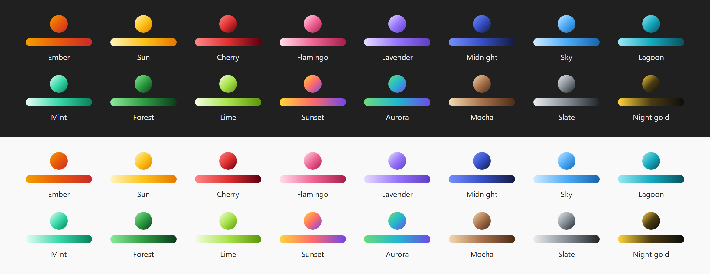
</p>

### Quiet start: normal, minimized or in the background
Per app: normal window, minimized, or in the background (straight to the notification area). StartQueue **knows how popular apps start quietly**, such as Discord, Steam, OneDrive, OBS, Edge and Battle.net, keeps what an app's own autostart entry already asked for, and learns from every app it takes over. For apps without such an option, StartQueue handles the window itself after the start. Apps that quit when their window is closed are remembered, so "Background" cannot end them by accident.

### Your own start parameters
Keep an app's parameters as they are, **add** your own after them (the app's ones stay untouched), or **replace** the whole line, starting from the one in use. This works for shortcuts too.

### Windows services, like services.msc
A separate **Services** view lists every Windows service: change the startup type (automatic, delayed, manual, disabled), start, stop or restart, search, sort and filter by startup type or state. Services of apps are kept apart from Windows services, and before you change a Windows service StartQueue tells you what can go wrong. Services are only managed, never taken over. Set up fully, a change asks nothing more; otherwise it asks through UAC, just like services.msc.

### Admin apps without the UAC prompt
Apps that need administrator rights start in your order too, without a UAC prompt at every sign-in. This needs the installation with admin rights.

### Nothing gets lost
Every entry StartQueue takes over can be **given back** to its original place in Windows, and uninstalling gives back all of them. Your list stays for a later installation. Export your list and settings to one file to keep them or take them to another PC, and go back to one of the last five states StartQueue saved by itself, for example from before an update (Settings > About > **Back up settings**).

### Feels like Windows 11
Light and dark following Windows, StartQueue's ember colors, the Windows accent color, quiet Sand or your profile's color, English and German, keyboard shortcuts, rounded corners and scrolling with the middle mouse button. Add apps by dragging them from the Start menu, through the Explorer context menu, or from suggestions based on what you use often.

## Screenshots

<table>
  <tr>
    <td width="50%">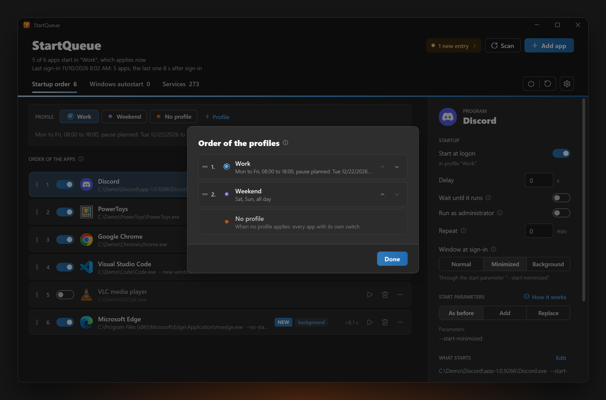<br><sub><b>Profiles:</b> drag them into order, plan a pause like an out-of-office reply</sub></td>
    <td width="50%">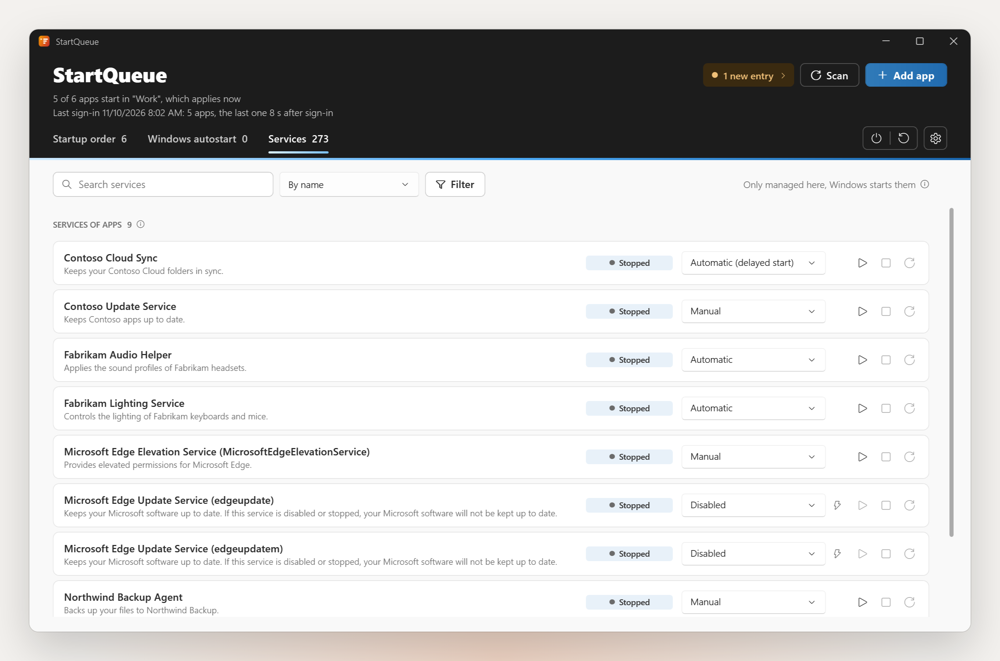<br><sub><b>Services:</b> startup type, start and stop, sorted and filtered</sub></td>
  </tr>
  <tr>
    <td width="50%">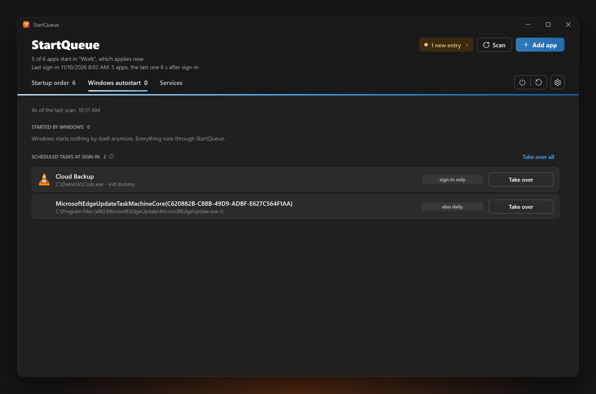<br><sub><b>Windows autostart:</b> what Windows still starts by itself, taken over with one click</sub></td>
    <td width="50%">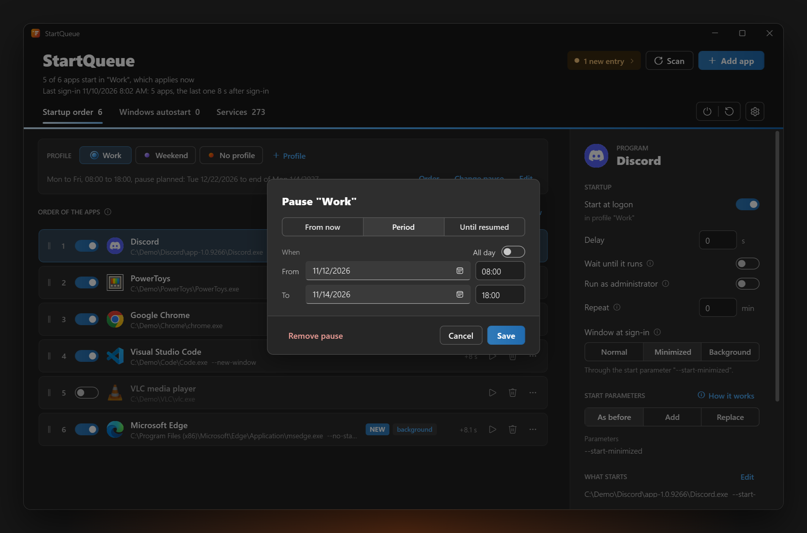<br><sub><b>Pause:</b> from now, for a planned period, or until you resume</sub></td>
  </tr>
  <tr>
    <td width="50%">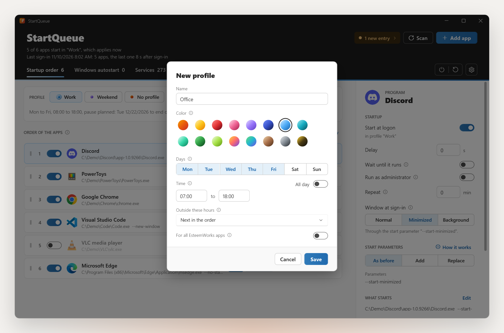<br><sub><b>Profile:</b> 16 colors, weekdays, hours or all day</sub></td>
    <td width="50%">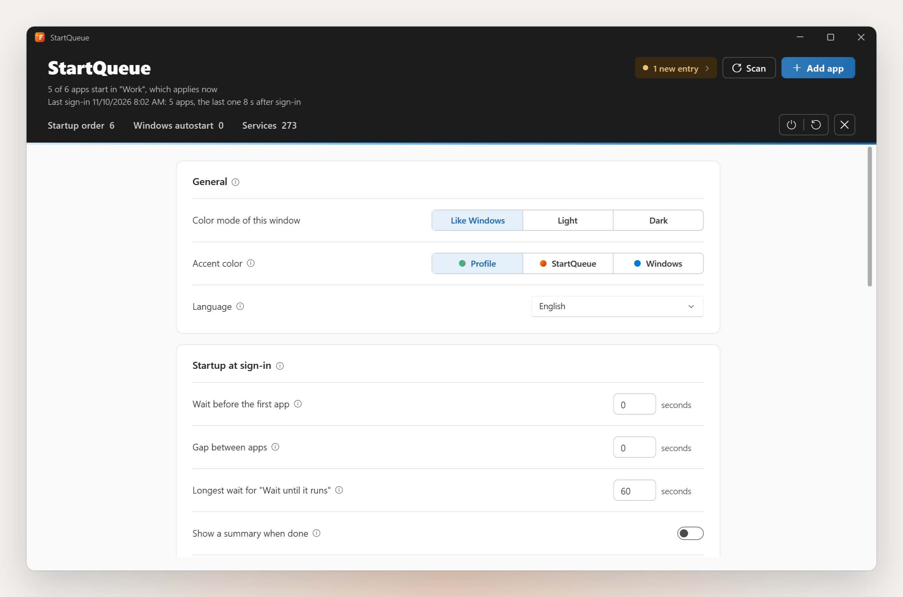<br><sub><b>Settings:</b> color mode, accent color and language, the startup at sign-in, how new entries are handled</sub></td>
  </tr>
  <tr>
    <td width="50%">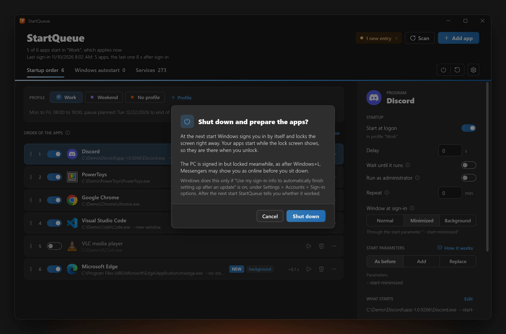<br><sub><b>Prepared shutdown:</b> says beforehand what happens and whether it can work</sub></td>
    <td width="50%">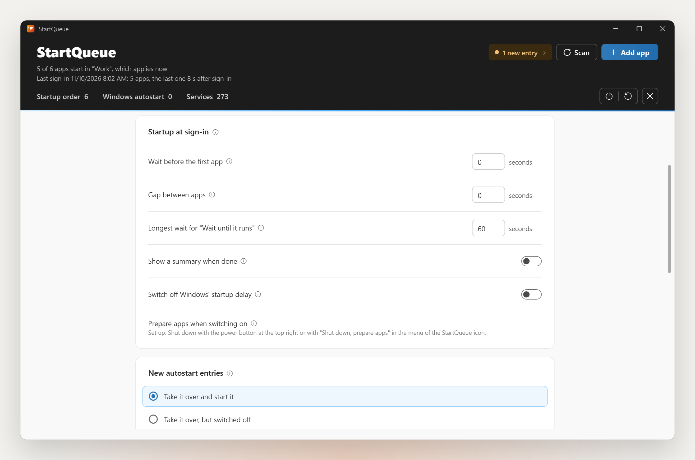<br><sub><b>Startup at sign-in:</b> waits, gaps, Windows' startup delay and prepared apps</sub></td>
  </tr>
</table>

## Download and install

Download `StartQueue-Setup-<version>.exe` from the [latest release](../../releases/latest) and run it, on Windows 11 or 10, 64 bit. The setup brings its own .NET and asks one question: **Basic, without admin rights** (chosen), or **Full, with admin rights** if you are an administrator. Full asks Windows once for your confirmation; after that StartQueue asks nothing more.

| | Full, with admin rights | Basic, without admin rights |
| --- | --- | --- |
| Start at sign-in | right away | right away where Windows allows it, otherwise a little later with the rest of the Windows autostart |
| Your own autostart entries | taken over | taken over |
| Entries for all users | taken over and given back without asking | stay with Windows |
| Start apps as administrator | without UAC prompt | not available |
| Explorer context menu | in the Windows 11 menu | under "Show more options" |
| Change Windows services | without UAC prompt | with UAC prompt and an admin account |
| Set up prepared shutdowns | with one click in the settings | an administrator has to set it up once |

**At the first start StartQueue changes nothing.** It shows what it found in the Windows autostart, and you choose in three steps: which apps it takes over (untick the ones Windows should keep), what happens when an app adds itself later, and when it switches on. **Look around first** opens StartQueue as a preview: every app shows in the order marked *still with Windows*, and what you arrange there stays when you switch on. Until then Windows starts everything as before. For deployments, `StartQueue.exe --switch-on` switches it on with everything found.

Full can also be set up later under **Settings > General > Set up fully** (one UAC prompt). A newer setup simply updates, without the question and without the introduction: your list and settings stay and StartQueue goes on as before. Uninstall through **Windows Settings > Apps**: every entry StartQueue took over goes back to Windows, your list stays for a later installation.

> [!NOTE]
> The setup is not signed with a public code signing certificate yet. Windows SmartScreen therefore warns about an unknown publisher: choose "More info", then "Run anyway". With Smart App Control or policies like AppLocker, WDAC or ASR rules, Windows may block it. No scanner on VirusTotal flags the setup of version 1.6.0: [report](https://www.virustotal.com/gui/file/9f92102955845bea803ef4345d204794dc94b2067e7be6c906ff1e7deeff7920).

## How it works

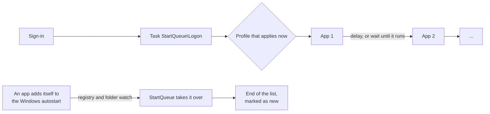

- **Taking over** means the entry is removed or switched off in Windows (Run values, shortcuts in the startup folders, startup tasks of Store apps, the sign-in trigger of scheduled tasks) and kept in StartQueue together with where it came from. Giving it back restores exactly that state.
- **Profiles** are checked from left to right; the first one that applies and is not paused decides, otherwise none does and every app starts by its own switch. Outside its hours a profile can also hand over to no profile or to a chosen one. A profile chosen by hand wins until its time is up. When a profile applies is kept in `%APPDATA%\EsteemWorks\profiles.json`, shared by the EsteemWorks apps; which apps start in it stays in StartQueue's `config.json`. Profiles of StartQueue 1.5 and before move there at the first start and stay in `config.json` as well, for going back.
- **Store apps** start the way their Windows startup task would, usually quietly in the notification area.
- **Starting:** apps start top to bottom. A delay holds back that app and everything after it; "wait until it runs" holds back the rest until the app is seen running. Every other start runs on its own, so the list moves on at once.
- **Watching:** changes to the Run keys and startup folders are noticed immediately; a full check, also through **Scan** or <kbd>F5</kbd>, finds new startup tasks, sign-in tasks and services.
- **Prepared shutdown:** StartQueue runs `shutdown /sg` (or `/g` to restart). Windows then signs in automatically after the start and locks at once, as it does after updates. Setting it up switches on that Windows option for your account and, if the PC only allows Windows Hello sign-in, switches that off; **Undo** puts back exactly what was there before.
- **Settings over versions:** a new version takes over the list and settings of every earlier one; when their shape changes, the old file is backed up first under `%APPDATA%\StartQueue\backups` and taken over step by step. Before every update, import and restore StartQueue saves the current state there too, the last five stay. A list that cannot be read is never replaced: StartQueue keeps a copy, says so under About and offers an earlier state.
- **First start:** a new installation (the setup's `--setup --new`) changes nothing in Windows until it is switched on. Until then each scan only fills the preview; a sign-in starts nothing through StartQueue. Switching on takes over what is ticked, with everything set for it in the preview; what is unticked goes on the keep list as *left with Windows by you*. An update or an installation over a list that stayed counts as switched on.
- **Admin rights:** the task `\StartQueue\Elevated` (the admin helper) takes over entries for all users, gives them back, starts apps as administrator, changes services and sets up prepared shutdowns, so a full setup never shows a UAC prompt. The tray app hands it each change and waits for its answer; the helper takes only these few commands. The tray app itself always runs with normal rights.
- **Apps of the EsteemWorks family** such as [DynaTones](https://github.com/esteemworks/DynaTones) are taken over quietly: first in the order, not marked as new. StartQueue tells them that it starts them (`HKCU\Software\EsteemWorks\Apps\StartQueue\Starts`), so their own "Start with Windows" switch shows the truth and turns StartQueue's entry on and off instead of writing the Run key again. A family app installed for all users stays in Windows, where it starts for everyone. Uninstalling StartQueue gives every family app its own start back.

## Keyboard and mouse

| | |
| --- | --- |
| Change the order | drag a row, or <kbd>Alt</kbd>+<kbd>↑</kbd> / <kbd>↓</kbd> |
| Switch on or off | the switch in the row, or <kbd>Space</kbd> |
| Start now | ▷ in the row, or <kbd>Enter</kbd> |
| Remove | the bin in the row, or <kbd>Del</kbd>, with undo |
| More actions | right-click a row, or ⋯ |
| Add an app | <kbd>Ctrl</kbd>+<kbd>N</kbd>, drag from the Start menu, or the Explorer context menu |
| Check everything | **Scan** or <kbd>F5</kbd> |
| Shut down or restart with prepared apps | the power buttons at the top right, or the tray menu |
| Scroll | mouse wheel, or hold the middle mouse button and drag |

## FAQ

**Is StartQueue a replacement for the startup apps page in Task Manager or Settings?**
Yes, and more. Task Manager can only switch autostart entries on or off. StartQueue also decides the order, delays, profiles, how windows come up, start parameters and services, and it keeps watching for apps that add themselves again.

**Will my PC start faster?**
StartQueue starts your apps earlier and in an order you choose, and Windows' own startup delay can be switched off. With delays and "wait until it runs" you can keep heavy apps from getting in the way of the ones you need first. How much you gain depends on your apps and your PC; the window shows when each app started at the last sign-in. The biggest step is a prepared shutdown: then the apps start before you even sign in.

**Is a prepared shutdown safe?**
After it, the PC is signed in but locked, as after <kbd>Windows</kbd>+<kbd>L</kbd>: unlocking needs your PIN, password or Windows Hello as always. Messengers may show you as online before you sit down. Windows uses the same automatic sign-in after updates. On devices that belong to an organization, StartQueue follows its rules and does not override them.

**Can I undo everything?**
Yes. Every entry can be given back to Windows on its own, and uninstalling gives back all of them.

**Can DynaTones use my profiles?**
Yes. Edit a profile, switch on **For all EsteemWorks apps**, and DynaTones offers it when you add a profile there. It stays one profile: change its name or hours in one app and the other follows. Removing it in one app leaves it in the other.

**How do I take my list to another PC?**
Settings > About > **Back up settings** > **Export** saves your list, profiles and settings in one zip file; **Import** on the other PC takes them over. The current settings are backed up first, and a file from an older StartQueue is taken over too. From a script: `StartQueue.exe --export <file.zip>` and `--import <file.zip>`. Apps your list names have to be installed there as well.

**What needs admin rights?**
Without admin rights, StartQueue manages your own autostart entries. The full feature set needs an installation with admin rights: then it also handles the autostart entries for all users, starts admin apps without a UAC prompt, puts its context menu in the Windows 11 menu and sets up prepared shutdowns with one click. The table under [Download and install](#download-and-install) shows the difference.

**What is the Windows startup delay?**
Windows waits a few seconds after sign-in before it starts the autostart apps. StartQueue can switch that off (Settings > Startup at sign-in) after asking you, since it takes care of the order itself.

**Does StartQueue send any data?**
No. It works on your device, without telemetry or account. Once a day it asks GitHub whether there is a new version, without sending anything about you; you can switch that off in the setup or under Settings > About > Updates. See [Privacy](PRIVACY.md).

**Does it work on Windows 10?**
Yes, 64 bit. A few details, like the context menu in the new Windows 11 menu, exist only on Windows 11.

## Privacy

StartQueue reads autostart entries, installed apps, running processes, services and, for suggestions, how often Windows counted an app being started. All of it stays on the device in `%APPDATA%\StartQueue`. Details in [PRIVACY.md](PRIVACY.md) and in the app under **Settings > About > Privacy and notices**.

## Troubleshooting

Under Settings, **Troubleshooting**: diagnostics mode writes every detail to the log for 24 hours and then turns
itself off; **Create diagnostics package** puts a zip on the desktop with the log, StartQueue's event log entries, the
list with its settings, the last run and how StartQueue is set up, with your user folder and name replaced by placeholders. Nothing is sent; you
decide whom you give it to. The same from a script or Intune: `StartQueue.exe --diagnostics [folder]` and
`--diagnostics-mode on|off|<hours>`.

The log is `%APPDATA%\StartQueue\StartQueue.log`, at most five files of 1 MB, none older than 30 days. Important events
also go to the Windows event log (Application, source **StartQueue**) once it is set up: by the setup's admin option,
offered to administrators, or with **Set up** under Troubleshooting. Both ask for admin rights once.

| Id | Event |
|---|---|
| 1000, 1001 | Started, stopped |
| 1010, 1011 | Set up, uninstalled |
| 1030, 1031 | Diagnostics mode on, off |
| 1040, 1041, 1042 | Update found, being installed, installed |
| 1050, 1051, 1052 | Settings taken over from an older version, imported or restored, exported |
| 1100, 1101 | Automatic sign-in for prepared shutdowns set up, undone |
| 1102 | A Windows service changed from the services view |
| 1103 | Windows' startup delay switched off or back on |
| 1104 | StartQueue switched on at the end of its first start |
| 2004 | The list could not be read; a copy is under `backups`, About offers an earlier state (3103 up to 1.5.2) |
| 2100 | An autostart entry or sign-in task taken over from Windows |
| 2101 | An entry given back to Windows |
| 2102 | An app put itself back into the autostart and was removed again |
| 3000, 3001 | An error, an error nothing else caught |
| 3010 | An update could not be installed |
| 3100 | An app did not start |
| 3101 | Taking over an entry failed |
| 3102 | Giving an entry back failed |
| 3104 | Saving the list failed |
| 3105 | Changing a service failed |
| 3106 | Changing the automatic sign-in failed |
| 3107 | The prepared shutdown failed |
| 9000 | Detail, only in diagnostics mode |

## Build from source

The app alone needs only the .NET 10 SDK: `dotnet build src\StartQueue` works as it is. StartQueue is built on EsteemWorks.Kit, the building blocks it shares with its sibling apps; the kit is not open source, and a compiled copy of it is in `kit\` (its license in `kit\LICENSE.txt`). With the kit's sources next to this repository as `..\EsteemWorks.Kit`, the build takes those instead.

The setup, the context menu package and the releases are built by the publisher. `build.ps1` needs in addition Visual Studio Build Tools with C++, the Windows SDK and Inno Setup 6 (`winget install JRSoftware.InnoSetup`); the tests in `tests\sandbox` run in Windows Sandbox through the kit's tools and need its sources.

```powershell
.\build.ps1 -Setup          # app with its own .NET and out\setup\StartQueue-Setup-<version>.exe
.\build.ps1                 # only the app, to out\app (needs .NET 10 on the device)
.\build.ps1 -Setup -KitPackage   # as a release: with the compiled kit in kit\ even when its sources are next to it
.\out\app\install.ps1       # development: installs the build like the setup (-UserMode: without admin features)
.\out\app\uninstall.ps1     # development: like uninstalling through Settings > Apps
```

Explorer only loads context menus in the Windows 11 menu from a signed package. `build.ps1` creates the certificate `CN=StartQueue` in the build machine's user store on its first run. The setup carries the public part and trusts it when the admin features are set up, only under "Trusted People", never as a root certificate.

| Folder | Contents |
| --- | --- |
| `src/StartQueue/Core` | scan, take over and give back, profiles, start parameters, launcher, watching, services, setup |
| `src/StartQueue/UI` | window (WPF), tray, icons, colors, animations |
| `shell` | context menu extension (C++, IExplorerCommand) |
| `package` | manifest of the context menu package |
| `installer` | setup (Inno Setup) |

Command line: `--autostart` (sign-in), `--add <file>`, `--show`, `--switch-on` (ends the first start, as the button does), `--elevated` (admin task), `--restore <id>`, `--restore-all`, `--service <action> <name>` (one service change, through the admin helper or UAC). Settings: `--export <file.zip>`, `--import <file.zip>` (a running StartQueue takes them over at once; exit code 1 when it failed). For setup and uninstall: `--setup [--admin] [--new]`, `--setup-admin`, `--setup-full` (Set up fully, one UAC prompt), `--uninstall`. For diagnostics: `--scan-report <file>`, `--snapshot <folder>` (before switching on with the steps of the introduction), `--perf <file>`.

`build.ps1 -Setup` signs the program files, the setup and its uninstaller with a public certificate when signing is
set up on the PC (environment variables, see EsteemWorks.Kit's `tools\sign.ps1`); otherwise it builds them as before
and says so in one line.

## Roadmap and changes

What is planned next, such as startup times across several sign-ins, start conditions like "only once the network is up" and the publisher of every entry, is in the [roadmap](ROADMAP.md). What changed in each version is in the [changelog](CHANGELOG.md). Found a security issue? See [SECURITY.md](SECURITY.md).

## Made with AI

StartQueue was developed with the help of AI: large parts of the code, texts and graphics were created with Claude by Anthropic, directed and tested by the author. The app itself contains no AI and sends no data to AI services.
